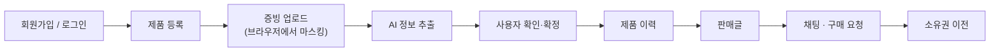
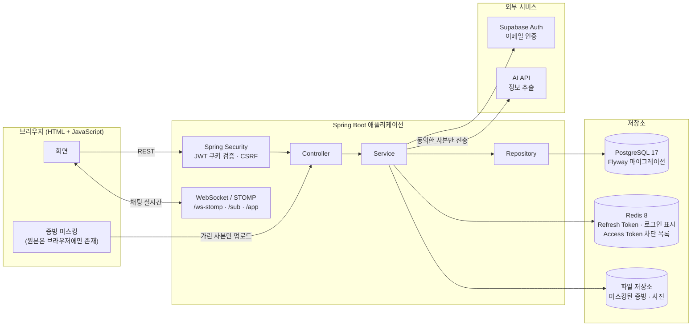
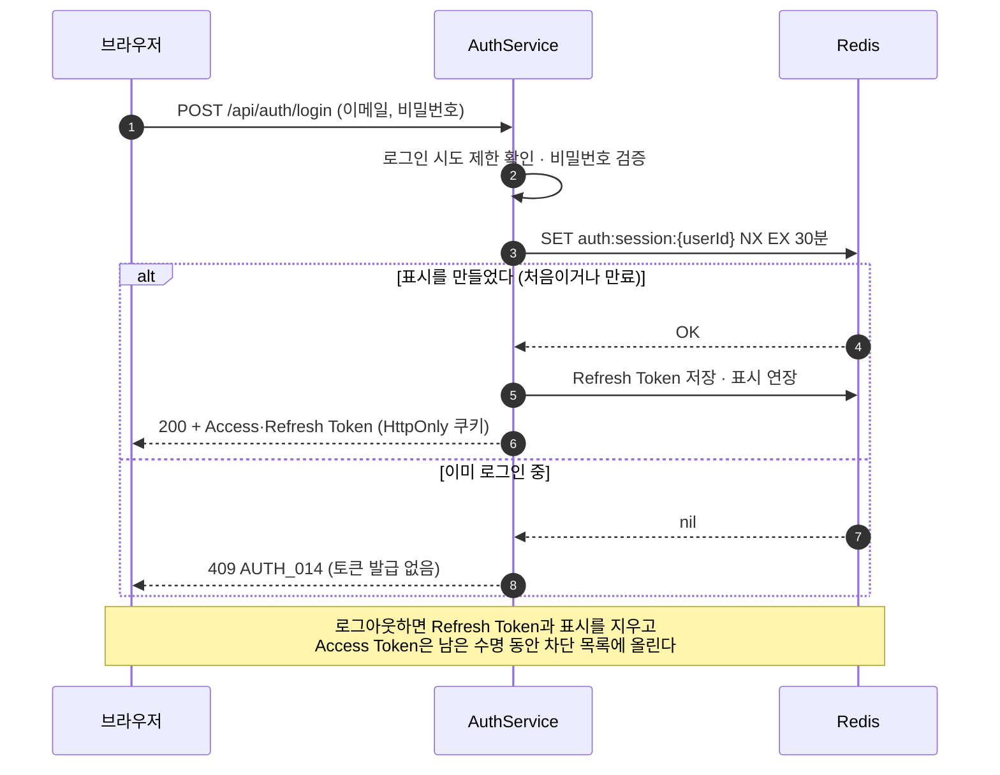
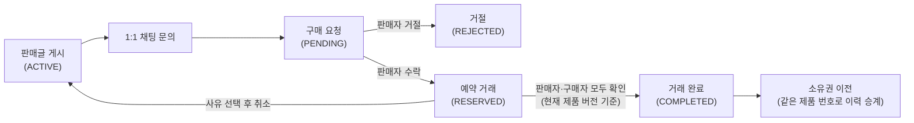
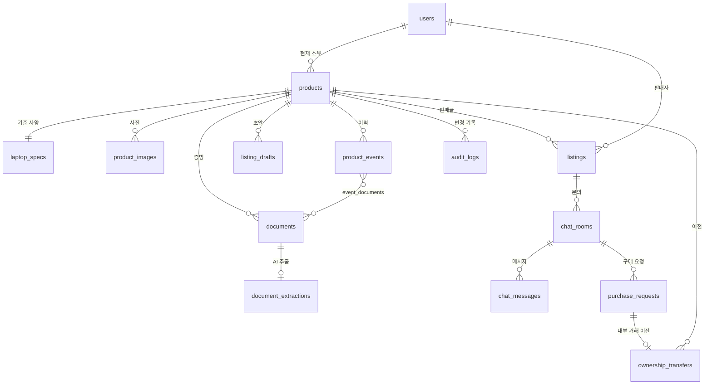

# Pastport

<!--
README 작성 전 채워야 할 항목 (완료하면 이 블록과 아래 TODO 주석을 지운다)

[필수]
4. 팀원 이름·담당 영역              → "팀원" 섹션 (GitHub 계정은 커밋 기록으로 채워 둠)

[확인]
5. 서비스 한 줄 소개 문구 확정      → 제목 바로 아래

[선택]
8. 로고 이미지
9. 주요 화면 스크린샷 또는 시연 링크
-->

> 노트북의 구매·수리 이력을 증빙과 함께 쌓아, 믿을 수 있는 중고거래로 이어 주는 서비스

<!-- TODO(5): 팀에서 쓰는 공식 소개 문구로 교체 -->
<!-- TODO(8): 로고 이미지를 넣을 경우 제목 위에 <p align="center"></p> 추가 -->

 전자제품 관리와 중고거래를 하나로 잇고, 초기 MVP는 **노트북**을 대상으로 한다.

중고 노트북은 "정말 관리가 잘 된 제품인지" 알기 어렵다. Pastport는 영수증·보증서·수리 명세서 같은 **증빙을 올리고, AI가 제품 정보를 읽어 주고, 사용자가 확인해서 이력으로 남기는 흐름**을 만든다. 그렇게 쌓인 이력이 판매글의 근거가 된다.



## 화면

<!-- TODO(9): 아래 표의 파일을 캡처해 docs/images/ 에 저장하고, 상태를 "완료"로 바꾼 뒤  로 본문에 넣는다.
     시연 영상이나 배포 주소가 있으면 이 섹션 맨 위에 링크를 추가한다. -->

캡처 이미지는 `docs/images/`에 둔다. 개인정보(이메일·시리얼·계좌·영수증 원문)가 보이지 않게 가린 뒤 저장한다.

| 화면 | 저장 경로 | 보여 줄 내용 | 상태 |
| --- | --- | --- | --- |
| 홈 | `docs/images/landing.png` | 검색, 카테고리, 방금 올라온 상품 | 캡처 필요 |
| 로그인 · 중복 로그인 차단 | `docs/images/login-blocked.png` | "이미 다른 곳에서 로그인되어 있어요" 안내 | 캡처 필요 |
| 제품 등록 | `docs/images/product-register.png` | 노트북 사양·사진 입력 | 캡처 필요 |
| 증빙 마스킹 | `docs/images/document-mask.png` | 브라우저에서 개인정보를 가리는 화면 | 캡처 필요 |
| AI 추출 확인 | `docs/images/ai-extraction.png` | 추출 후보를 사용자가 확인·수정 | 캡처 필요 |
| 제품 이력 | `docs/images/history-timeline.png` | 구매·수리·부품 교체 타임라인 | 캡처 필요 |
| 판매글 | `docs/images/listing.png` | 이력이 근거로 붙은 판매글 | 캡처 필요 |
| 채팅 · 구매 요청 | `docs/images/chat.png` | 1:1 채팅, 구매 요청 | 캡처 필요 |
| 마이페이지 | `docs/images/mypage.png` | 요약 띠, 최근 항목 | 캡처 필요 |

## 핵심 포인트

- **개인정보를 서버에 남기지 않는 증빙 처리:** 원본은 브라우저에서만 다루고, 사용자가 가린 사본만 서버로 올린다.
- **AI는 초안만 만들고 확정은 사람이 한다:** AI가 뽑은 값은 후보일 뿐이며, 사용자가 검토·수정한 값만 이력에 반영한다.
- **오래된 결과가 최신을 덮어쓰지 못하게 하는 버전 관리:** 문서·제품·판매글에 버전 번호를 두고 확인한 버전이 다르면 거부한다.
- **소유자는 제품 한 곳만 기준:** 제품이 양도돼도 같은 제품 번호에 사진·증빙·이력이 이어진다.
- **스키마는 Flyway로만 변경:** 상태 규칙은 코드와 DB 제약 양쪽에서 막는다.

## 주요 기능

MVP 범위(P0/P1)는 [MVP 범위 설정](docs/MVP_SCOPE.md), 세부 동작·권한·예외는 [요구사항 정의서](docs/REQUIREMENTS.md)를 따른다.

| 영역 | 내용 | 패키지 |
| --- | --- | --- |
| 회원·인증 | 이메일 인증 회원가입, 로그인·로그아웃, 프로필 사진, 계정당 한 곳에서만 로그인 | `auth` |
| 제품 | 노트북 등록, 목록·상세, 사양·사진 관리, 시리얼 기반 중복 등록 방지 | `product` |
| 증빙·AI | 브라우저 마스킹 후 사본 업로드, AI 정보 추출, 사용자 확인·수정 | `document`, `ai` |
| 제품 이력 | 구매·점검·수리·부품 교체·소유권 이전 타임라인 | `history` |
| 판매글 | 임시저장, 게시, 이력 공개·정정 | `listing` |
| 채팅·거래 | 1:1 채팅, 구매 요청, 거래 완료 | `chat`, `trade` |
| 소유권 | 거래 완료 후 소유권 이전, 같은 제품 번호로 이력 승계 | `ownership` |
| 관리자 | 읽기 전용 관리 화면 | `admin` |

### 로그인 정책

- **계정당 한 곳에서만 로그인한다.** 이미 로그인 중인 계정은 같은 브라우저든 다른 기기든 새 로그인을 거부한다(`409`, `AUTH_014`). 비밀번호가 맞은 뒤에만 확인하므로, 틀린 비밀번호로는 로그인 여부를 알 수 없다.
- **동시에 로그인해도 한 곳만 성공한다.** Redis `SET NX`로 "로그인 중" 표시를 원자적으로 만들고, 먼저 만든 요청만 토큰을 발급받는다.
- **로그인 중 표시는 30분간 유지된다.** 토큰을 갱신할 때마다 연장되므로 사용 중에는 유지되고, 로그아웃 없이 창을 닫으면 30분 뒤 다시 로그인할 수 있다. 로그아웃하면 바로 풀린다.
- Access·Refresh Token은 HttpOnly 쿠키로 내려가고, Refresh Token은 Redis에서 관리한다. 쓰기 요청은 `X-XSRF-TOKEN` 헤더로 CSRF를 검사한다.
- 로그인한 상태에서 뒤로 가기 등으로 로그인·회원가입 화면이 열리면 안내 후 홈 화면으로 이동한다.

## 팀원

<!-- TODO(4): 팀원 이름과 담당 영역을 채운다. GitHub 계정은 커밋 기록에서 확인한 값이다.
     (이 목록에 없는 팀원이 있으면 직접 추가) -->

| 이름  | GitHub | 담당 |
|-----| --- | --- |
| 정태현 | [JtaeHyeon](https://github.com/JtaeHyeon) | TODO |
| 남윤아 | [yeunyeuna](https://github.com/yeunyeuna) | TODO |
| 박정민 | [pjmoo](https://github.com/pjmoo) | TODO |
| 박한솔 | [goarns77](https://github.com/goarns77) | TODO |
| 정주성 | [Seong0321](https://github.com/Seong0321) | TODO |

## 기술 스택

| 구분 | 내용 |
| --- | --- |
| Backend | Java 17, Spring Boot 4.1.1, Spring Web MVC, Spring Data JPA, Bean Validation, Gradle 9.7.1 |
| 인증 | Spring Security, OAuth2 Resource Server (HS256 JWT) |
| DB | PostgreSQL 17, Flyway(스키마 마이그레이션) |
| 캐시·토큰 | Redis 8 |
| API 문서 | springdoc OpenAPI (Swagger UI) |
| Frontend | HTML + JavaScript (`src/main/resources/static`) |
| 테스트·품질 | JUnit 5, Mockito, Spotless(google-java-format) |
| 실행 환경 | Docker Compose (PostgreSQL · Redis) |

기술 기준과 사용하지 않는 기술(pgvector, RAG, Kafka 등)은 [초기 세팅 가이드](INITIAL_SETUP.md)를 본다.

## 아키텍처

### 시스템 구성



- 원본 증빙과 마스킹 전 문서는 서버나 외부 AI로 보내지 않는다.
- 로그인 관련 상태(Refresh Token, 로그인 중 표시, 로그아웃된 Access Token)는 모두 Redis에 둔다.

### 계층 구조

```text
Controller → Service → Repository → Entity
```

- Controller에는 비즈니스 로직을 두지 않고, Repository를 직접 호출하지 않는다.
- API 요청·응답은 DTO를 쓰며 Entity를 그대로 반환하지 않는다.
- 도메인별 패키지(`auth`, `product`, `document`, `history`, `listing`, `chat`, `trade`, `ownership`, `ai`, `admin`)와 공통 코드(`common`)로 나눈다.

### 로그인 흐름 (중복 로그인 차단)



- `SET NX`는 Redis에서 원자적으로 처리되므로 동시에 요청해도 먼저 처리된 한 곳만 성공한다.

### 거래 흐름



- 수락해도 다른 대기 요청은 유지하고, 거래가 완료되면 다른 대기 요청은 거절한다.
- 예약 중 새 이력이 생기면 양측 확인을 초기화해 다시 받는다.
- 예약을 취소하면 판매글이 다시 `ACTIVE`가 되고 내부 이전도 취소된다.

세부 상태와 전이 규칙은 [채팅·거래 코드 가이드](docs/development/chat-trade-code-guide.md)와 [요구사항 정의서](docs/REQUIREMENTS.md)를 따른다.

### 데이터 모델 (핵심 관계)

전체 컬럼과 제약은 [ERD 문서](docs/ERD.md)를 본다. 아래는 주요 테이블 사이의 관계만 요약한 것이다.



## 로컬 실행

### 1. 준비

- JDK 17
- Docker Desktop 또는 Docker Engine + Docker Compose

### 2. 환경 변수

```bash
cp .env.example .env
```

`.env`는 Git에서 제외된다. 비밀번호·JWT 키·API 키는 저장소에 커밋하지 않는다.

`.env.example`의 변수는 다음과 같다. 값은 `.env`에만 두고 저장소에 커밋하지 않는다.

| 변수 | 용도 |
| --- | --- |
| `POSTGRES_DB` · `POSTGRES_USER` · `POSTGRES_PASSWORD` · `POSTGRES_PORT` | Docker PostgreSQL 설정 |
| `DB_URL` · `DB_USERNAME` · `DB_PASSWORD` | 애플리케이션 DB 접속 정보 (로컬에서는 `POSTGRES_*`와 같은 값) |
| `JWT_SECRET` | HS256 JWT 검증 키 (32바이트 이상, 배포에서는 로컬 값 사용 불가) |
| `REDIS_HOST` · `REDIS_PORT` · `REDIS_PASSWORD` · `REDIS_SSL_ENABLED` | Redis 접속 정보 (로컬 기본값 제공) |
| `CORS_ALLOWED_ORIGINS` | 허용할 프런트엔드 Origin |
| `LOCAL_STORAGE_ROOT` | 로컬 파일 저장 경로 (기본 `./storage`) |
| `PRODUCT_SERIAL_SECRET` | 제품 시리얼 보호 키 (`prod` 프로필에서는 필수) |
| `CHAT_API_ENABLED` | 채팅 API 사용 여부 |
| `AI_API_KEY` | AI 연동 키 |
| `SUPABASE_URL` · `SUPABASE_SECRET` | 이메일 인증(Supabase Auth). 실제 값은 `.env`에만 둔다 |
| `SUPABASE_DB_*` | Supabase DB를 쓸 때만 필요하며 `SPRING_PROFILES_ACTIVE=supabase`로 켠다 |
| `TEST_DB_*` · `TEST_JWT_SECRET` | 테스트용 DB·JWT 키 (`aibe7_test`) |

> Docker Compose는 `.env`를 자동으로 읽지만, Spring Boot와 IntelliJ 실행 구성은 읽지 않는다. 실행 구성의 환경 변수에 `DB_PASSWORD`, `JWT_SECRET`을 직접 등록한다.

### 3. DB와 Redis 실행

```bash
docker compose up -d
docker compose ps
```

처음 실행하면 애플리케이션 DB `aibe7`과 테스트 DB `aibe7_test`가 함께 만들어진다. 로컬 데이터를 모두 지우고 다시 시작하려면 `docker compose down -v`를 쓴다(볼륨 삭제).

### 4. 애플리케이션 실행

IntelliJ에서 `SpringTestCiApplication`을 실행한다. 기본 프로필은 `local`이다.

실행 후 API 문서는 다음 주소에서 확인한다.

```text
http://localhost:8080/swagger-ui.html
```

> `Port 8080 was already in use`로 시작이 실패하면 이전에 띄운 앱이 아직 떠 있는 것이다. IntelliJ에서 정지해도 남는 경우가 있으니 `netstat -ano | findstr :8080`으로 PID를 확인해 종료한다. 그 밖의 문제는 [트러블슈팅](TROUBLESHOOTING.md)을 본다.

### 5. 테스트

```bash
./gradlew spotlessCheck
./gradlew test
./gradlew build
```

## 폴더 구조

| 경로 | 내용 |
| --- | --- |
| `src/main/java/org/example/springtestci/` | 백엔드 소스 (도메인별 패키지 + `common`) |
| `src/main/resources/db/migration/` | Flyway 마이그레이션 |
| `src/main/resources/static/` | 화면 (HTML·CSS·JS) |
| `docs/` | 기능별 설계·구현 문서 |
| `scripts/` | 데모·점검 스크립트 |
| `compose.yaml` | 로컬 PostgreSQL · Redis |

## 문서

| 문서                                                        | 내용 |
|-----------------------------------------------------------| --- |
| [환경 세팅 가이드](INITIAL_SETUP.md)                             | 개발 환경, 공통 코드, 패키지 구조, 실행 방법 |
| [개발규칙](AGENTS.md)                                         | 프로젝트 공통 개발 규칙 |
| [요구사항 정의서](docs/REQUIREMENTS.md) | 기능 요구사항, 권한, 상태, 예외 처리 |
| [MVP 범위 설정](docs/MVP_SCOPE.md) | P0(반드시 구현)와 P1(확장) 기능 구분 |
| [ERD](docs/ERD.md) | 테이블·제약·관계 |
| API 명세 | 서버 실행 후 [Swagger UI](http://localhost:8080/swagger-ui.html) (springdoc 자동 생성) |
| [코딩 컨벤션](docs/CODING_CONVENTION.md) | 코드 작성·구현 기준 |
| [Git 협업 컨벤션](docs/GIT_CONVENTION.md) | 브랜치·커밋·PR·코드 리뷰 기준 |
| [운영·검증 기준](docs/OPERATIONS.md) | HTTPS·인증 쿠키 등 비기능 요구사항 기준 |
| [채팅·거래 코드 가이드](docs/development/chat-trade-code-guide.md) | `chat`, `trade` 상세 흐름 |
| [트러블슈팅](TROUBLESHOOTING.md) | 겪었던 문제와 해결 과정 |

## 협업 규칙

자세한 기준은 [Git 협업 컨벤션](docs/GIT_CONVENTION.md)을 따른다.

| 항목 | 형식 | 예 |
| --- | --- | --- |
| 브랜치 | `<종류>/<작업-내용>` (영문 소문자·하이픈, 종류: `feature` `fix` `refactor` `test` `docs` `chore`) | `feature/product-register` |
| 커밋 | `<type>(<scope>): <subject>` (한국어, 50자 내외, 마침표 없음) | `fix(auth): JWT 만료 처리 오류 수정` |

- 기능은 포크에서 브랜치를 만들어 작업하고, 원본 `main`으로 **Pull Request**를 보낸다. `main`에 직접 푸시하지 않는다.
- DB 스키마 변경은 반드시 **Flyway 마이그레이션**으로 하고, 기존 마이그레이션 파일은 수정하지 않는다. `ddl-auto=update`에 의존하지 않는다.
- 새 기능과 주요 비즈니스 로직에는 테스트를 작성한다.
- PR 전에 `spotlessCheck`, `test`, `build`를 통과시킨다.
- 인증·인가와 다른 사용자의 데이터 접근 여부를 확인하고, 비밀번호·토큰·API 키를 코드나 로그에 남기지 않는다.
- 공통 설정(`SecurityConfig`, `application.yaml`, 공용 저장소 등)을 바꾸는 PR은 추가 리뷰를 받는다.
